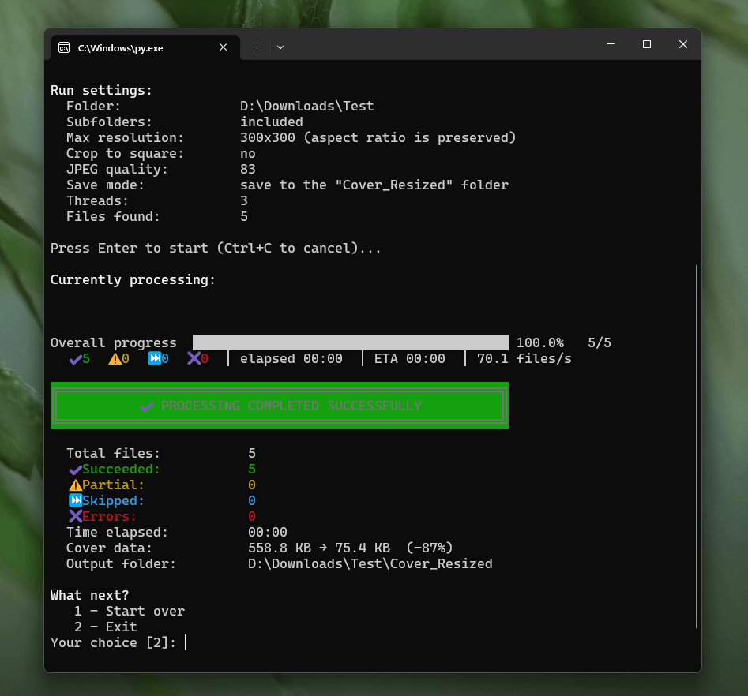

# Media File Cover Resizer Py



**Shrink the cover art embedded in your music and media files, in bulk.**

Media File Cover Resizer Py is a cross-platform Python tool that finds the embedded cover images in your media files and re-encodes them as small, clean, highly compatible JPEGs. Oversized covers (1000×1000, 3000×3000 and beyond) are a common cause of bloated libraries, slow-loading players, and car stereos or portable devices that refuse to show artwork at all. This tool fixes that without touching anything else in your files.

```
╔════════════════════════════════════════════════════════╗
║            ✔  PROCESSING COMPLETED SUCCESSFULLY        ║
╚════════════════════════════════════════════════════════╝

  Total files:           1248
  ✔ Succeeded:           1248
  Cover data:            3.2 GB → 96.4 MB  (-97%)
```

## Features

- **Resize to any resolution**: e.g. `300x300`. The aspect ratio is never changed, and neither side exceeds the limit you set. Small images are never upscaled.
- **Optional center crop to a 1:1 square** for non-square covers (off by default).
- **Adjustable JPEG quality** (default `83`).
- **Compatibility-first JPEG output**: baseline (non-progressive), 4:2:0 chroma subsampling, converted to sRGB, transparency flattened onto white, and **no EXIF data** at all.
- **Non-English tags are safe**: only the picture is replaced. Cyrillic, CJK, Arabic and other tags are preserved byte-for-byte, and the ID3v2 version (2.3 / 2.4) and any legacy ID3v1 block are kept as they were.
- **Three save modes**:
  1. Replace the original files
  2. Save to a `Cover_Resized` folder (the directory structure is mirrored) *(default)*
  3. Save next to the originals with a `_1` suffix
- **Folder picker button** (GUI) with a console fallback; subfolders can be included or excluded (included by default).
- **Multithreaded processing** with a configurable number of simultaneous files (1 by default).
- **Live progress display**: a progress bar for each file being processed, plus overall progress with counters, elapsed time, ETA and speed.
- **Detailed `.log` report** when anything is skipped, partially processed or fails, with a plain-English reason for every file.
- **Clear completion banner** and a *Start over / Exit* prompt, so you can run several jobs in one session.
- Safe interruption with `Ctrl+C`: running files finish cleanly and the rest are reported as not processed.

## Supported formats

| Format | Extensions | Cover storage |
|---|---|---|
| MP3, WAV, AIFF, DSF, TTA | `.mp3` `.wav` `.aif` `.aiff` `.dsf` `.tta` | ID3 `APIC` frames |
| FLAC | `.flac` | FLAC picture blocks |
| MPEG-4 audio/video | `.m4a` `.m4b` `.mp4` `.m4v` | `covr` atom |
| Ogg Vorbis / Opus / FLAC / Speex | `.ogg` `.oga` `.opus` `.spx` | `METADATA_BLOCK_PICTURE` |
| Windows Media | `.wma` `.asf` | `WM/Picture` |
| APEv2-tagged | `.ape` `.wv` `.mpc` | `Cover Art (…)` items |

> MP3, FLAC and M4A are the most thoroughly tested. Not supported: Matroska/WebM attachments and AAC files without a tag container.

If a file contains several embedded pictures (front cover, back cover, …), all of them are processed.

## Requirements

- Python **3.8** or newer
- [Pillow](https://python-pillow.org/) ≥ 9.1
- [mutagen](https://mutagen.readthedocs.io/) ≥ 1.45
- `tkinter` for the folder-picker window (included with Python on Windows and macOS; on Debian/Ubuntu install it with `sudo apt install python3-tk`). Without it, the tool simply asks for the folder path in the console.

## Installation

```bash
git clone https://github.com/<your-username>/media-file-cover-resizer-py.git
cd media-file-cover-resizer-py
pip install -r requirements.txt
```

## Usage

Run the script from the folder you want to process, or choose another folder in the window that opens:

```bash
python cover_resizer.py
```

You will be asked the following questions. Press **Enter** to accept the default shown in brackets.

| # | Question | Default |
|---|---|---|
| – | Folder to process (window with a **Choose another folder…** button) | current directory |
| 1 | Maximum cover resolution (`300x300`, `500`, `600x400`, …) | `300x300` |
| 2 | Crop to a centered 1:1 square if the cover isn't square? | No |
| 3 | JPEG quality (1–100) | `83` |
| 4 | Process subfolders? | Yes |
| 5 | Save mode: `1` replace · `2` `Cover_Resized` folder · `3` `_1` suffix | `2` |
| 6 | Number of files processed simultaneously (threads) | `1` |

After a summary of the chosen settings, press Enter to start. When the run finishes you can choose **Start over** or **Exit**.

### Example session

```
1) Maximum cover resolution, e.g. 300x300 [300x300]:
2) Crop to a centered 1:1 square if the cover is not square? [y/N]:
3) JPEG quality (1-100) [83]:
4) Process subfolders? [Y/n]:
5) How to save the results:
     1 - replace the original files
     2 - save to the "Cover_Resized" folder
     3 - save next to the originals with a "_1" suffix
   Your choice [2]:
6) Number of files to process simultaneously (threads, 1-64; CPU cores here: 8) [1]: 4
```

### Resizing rules

| Original | Settings | Result |
|---|---|---|
| 1200×800 | `300x300` | 300×200 (aspect ratio kept) |
| 1200×800 | `300x300`, crop on | 300×300 (center square) |
| 500×500 | `300x300` | 300×300 |
| 200×200 | `300x300` | 200×200 (never upscaled, only re-encoded) |
| 800×1200 | `400x300` | 200×300 (fits within both limits) |

### Save modes

| Mode | What happens | Good for |
|---|---|---|
| **1 – Replace** | Cover is rewritten inside the original file. | Final cleanup of a library you have backed up. |
| **2 – `Cover_Resized`** | Files are copied to `<folder>/Cover_Resized/…` (subfolder structure preserved) and modified there. Only files that were actually processed are copied. | Safe default; originals stay untouched. |
| **3 – `_1` suffix** | `song.mp3` → `song_1.mp3` in the same folder. Existing `_1` files are never overwritten, and earlier `_1` copies are skipped on re-runs. | Side-by-side comparison. |

> ⚠️ **Mode 1 modifies files in place.** Always keep a backup of anything you can't replace.

### Log file

If any file is skipped, partially processed, or fails, a log named `Cover_Resizer_YYYY-MM-DD_HH-MM-SS.log` is written to the processed folder, and its path is shown at the end of the run. Each entry looks like this:

```
[ERROR] Albums/Broken Track.mp3
    Reason: Failed to read/write tags: the file is corrupted or has a non-standard structure. [HeaderNotFoundError: can't sync to MPEG frame]

[SKIPPED] Singles/Demo.flac
    Reason: No embedded cover found.
```

Typical reasons: no embedded cover, no tags, corrupted file or cover image, file locked by another program, read-only file, not enough disk space.

## How it works

1. The folder is scanned for supported media files (the `Cover_Resized` output folder is excluded automatically).
2. For each file, embedded pictures are read with [mutagen](https://mutagen.readthedocs.io/).
3. Each picture is decoded, auto-rotated according to its EXIF orientation, flattened/converted to sRGB, optionally center-cropped, downscaled with a high-quality Lanczos filter, and saved as baseline JPEG without metadata.
4. The new picture replaces the old one in the file's tags (in the original or in the copy, depending on the save mode). All other tags and the audio data stay as they were.

## Tips

- On an SSD, 4–8 threads are usually a good balance. On a network drive or an HDD, keep it at 1–2.
- Common cover-size choices: `300x300` for portable players and cars, `500x500` for desktop players, `600x600` for most streaming-style libraries.
- Quality `80–85` is visually almost lossless at these sizes while keeping files tiny.
- Set the `NO_COLOR` environment variable to disable colored output.

## Troubleshooting

| Problem | Solution |
|---|---|
| `Required libraries are missing` | Run `pip install -r requirements.txt`. |
| No folder window appears | `tkinter` is missing or there's no display; type the path in the console instead (on Debian/Ubuntu: `sudo apt install python3-tk`). |
| Weird characters / no colors in the console | Use Windows Terminal, PowerShell or a modern terminal emulator. |
| Many files reported as "No embedded cover found" | Those files have no embedded art (cover may be a separate `folder.jpg`, which this tool doesn't touch). |
| "Access denied" errors | Close the player or other program using the files and check the files aren't read-only. |

## Contributing

Issues and pull requests are welcome. If you hit a file that fails, please open an issue and attach the relevant part of the `.log` file (and the file format/encoder if you know it).

## Credits
The code was written using web version of Claude Sonnet 5.5 😁.

## License

[MIT](LICENSE)
